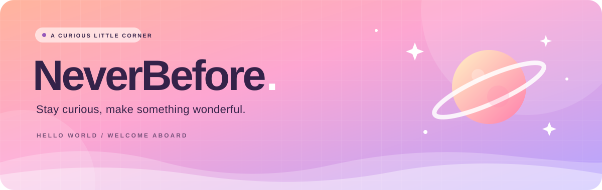
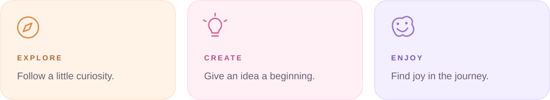

  

  

<h2 align="center">你好，我是 NeverBefore 👋</h2>

  欢迎来到我的 GitHub 小天地。 
  <b>🌈 保持好奇 &nbsp; · &nbsp; 💡 留住灵感 &nbsp; · &nbsp; 🚀 把想法变成现实</b>

 

  

  为探索与创造，留一小块空间。 
  Stay curious. Make something. Enjoy the journey.

 

  

